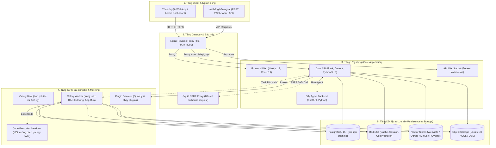
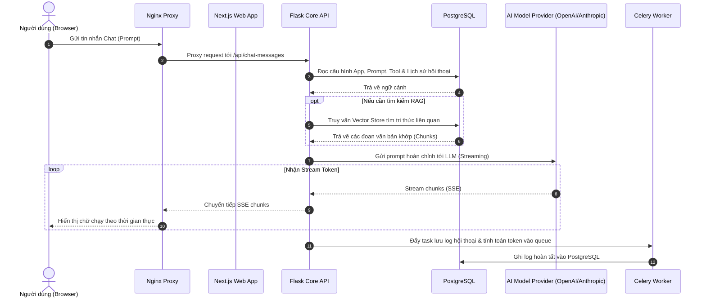

# Kiến Trúc Dự Án & Tech Stack — Dify

Tài liệu này cung cấp cái nhìn toàn diện về **kiến trúc hệ thống**, **cấu trúc thư mục (Monorepo)** và **ngăn xếp công nghệ (Tech Stack)** của nền tảng **Dify**.

---

## 1. Sơ đồ kiến trúc tổng thể (System Architecture)

Dify được tổ chức theo mô hình phân tán dạng module hóa, triển khai qua Docker Compose hoặc Kubernetes với các thành phần chuyên biệt:



---

## 2. Cấu trúc thư mục Monorepo

Dify là một **Monorepo** bao gồm toàn bộ các thành phần mã nguồn từ frontend, backend, agent runtime, CLI, bộ thư viện dùng chung cho đến hạ tầng docker:

```text
dify/
├── api/                  # Core Backend Service (Flask, Celery, SQLAlchemy, DDD)
├── web/                  # Frontend Web Application (Next.js, React 19, Tailwind)
├── dify-agent/           # Standalone Agent Backend & Logic
├── dify-agent-runtime/   # Agent runtime & môi trường sandbox
├── packages/             # Các thư viện & gói dùng chung (Internal Monorepo Packages)
│   ├── dify-ui/          # Design system & UI components
│   ├── contracts/        # API contracts & schema dùng chung
│   ├── openapi-content-mapper/ # Mapper cho OpenAPI schema
│   ├── iconify-collections/    # Icon packages
│   └── dev-proxy/        # Development proxy tooling
├── docker/               # Cấu hình triển khai Docker Compose, Nginx, biến môi trường
├── cli/                  # Dify CLI tool (dành cho lập trình viên & devops)
├── e2e/                  # Bộ kiểm thử tích hợp đầu cuối (Playwright + Cucumber)
├── sdks/                 # Thư viện client SDKs (Python, Node.js)
├── dev/                  # Scripts hỗ trợ phát triển local
├── docs/                 # Tài liệu kỹ thuật, kiến trúc & đa ngôn ngữ
├── package.json          # Root package.json (pnpm workspace)
├── pnpm-workspace.yaml   # Cấu hình monorepo workspace cho Node.js
└── AGENTS.md             # Quy tắc hướng dẫn dành cho AI Agents phát triển dự án
```

---

### 2.1. Chi tiết thư mục `api/` (Backend Core)

Backend được tổ chức theo kiến trúc **Ports-and-Adapters (Hexagonal)** kết hợp **Domain-Driven Design (DDD)**:

```text
api/
├── controllers/          # Tầng Transport (Handlers, Routes, REST APIs, Auth admission)
│   ├── console/          # APIs cho trang quản trị Workspace/Apps/Datasets
│   ├── service_api/      # APIs mở rộng (public API keys cho client tích hợp)
│   └── web/              # APIs phục vụ WebApp chat/completion công khai
├── services/             # Tầng Application Services (Orchestration, use cases)
│   ├── app/              # Nghiệp vụ liên quan đến ứng dụng
│   ├── dataset/          # Nghiệp vụ quản lý tri thức, RAG, documents
│   └── ...
├── domain/               # Tầng Domain thuần túy (Không I/O, Aggregates, Entities, Invariants)
│   ├── workflow_comments/# Domain model bình luận trong workflow
│   └── ...
├── repositories/         # Tầng Adapter Persistence (SQLAlchemy mapping, query, session)
├── models/               # SQLAlchemy ORM Model definitions (Ánh xạ các bảng DB)
├── core/                 # Execution Kernel (LLM providers, RAG extraction, prompt engine)
│   ├── model_runtime/    # Provider LLM, Text Embedding, Rerank, Moderation
│   ├── rag/              # Trích xuất, làm sạch, chunking, lập chỉ mục tài liệu
│   └── workflow/         # Engine thực thi đồ thị Workflow / Chatflow
├── tasks/                # Tác vụ bất đồng bộ Celery (Indexing, mail, async runs)
├── extensions/           # Các tiện ích mở rộng Flask (Database, Redis, Storage, Mail)
├── configs/              # Hệ thống Pydantic Settings & biến môi trường
├── migrations/           # Alembic database migrations (Phiên bản schema DB)
├── pyproject.toml        # Định nghĩa dependencies (quản lý bởi uv)
└── app.py                # Điểm khởi chạy ứng dụng Flask
```

---

### 2.2. Chi tiết thư mục `web/` (Frontend)

Frontend sử dụng **Next.js App Router** với kiến trúc module hóa theo tính năng:

```text
web/
├── app/                  # Next.js App Router (Layouts, Pages, Routes)
│   ├── (commonLayout)/   # Nhóm route có chung layout chính (Apps, Datasets, Tools)
│   │   ├── apps/         # Danh sách & chi tiết ứng dụng
│   │   ├── datasets/     # Quản lý kho tri thức (Knowledge Base)
│   │   └── tools/        # Quản lý Tools & Plugins
│   ├── app/              # Các màn hình thiết kế App (Workflow Canvas, Prompt Studio)
│   └── install/          # Trang cài đặt khởi tạo tài khoản quản trị ban đầu
├── features/             # Business features độc lập
├── service/              # Tầng gọi API Backend (sử dụng ky / fetch / SWR)
├── context/              # React Context Providers toàn cục
├── hooks/                # Custom React Hooks
├── i18n/                 # Đa ngôn ngữ (react-i18next, hỗ trợ vi-VN, en-US, zh-CN, ...)
├── themes/               # Cấu hình giao diện, dark mode, màu sắc
├── types/                # TypeScript interface & type definitions
├── next.config.ts        # Cấu hình Next.js (headers, rewrites, webpack/turbopack)
└── package.json          # Quản lý thư viện frontend
```

---

## 3. Tech Stack Chi Tiết

### 3.1. Frontend Stack

| Phân loại | Công nghệ | Mục đích sử dụng |
| :--- | :--- | :--- |
| **Framework** | **Next.js 15+** | React framework hỗ trợ SSR, SSG và App Router |
| **Thư viện lõi** | **React 19** & **TypeScript** | Xây dựng UI phản hồi cao với kiểm tra kiểu chặt chẽ |
| **Styling** | **Tailwind CSS** | Tiện ích CSS hiện đại, linh hoạt |
| **Workflow Canvas** | **ReactFlow** + **Elkjs** | Dựng giao diện thiết kế luồng trực quan (Workflow/Chatflow DAG) |
| **State Management** | **Jotai** & **TanStack Query** | Quản lý state nguyên tử (atomic) và đồng bộ dữ liệu server cache |
| **Rich Text Editor** | **Lexical** & **Monaco Editor** | Soạn thảo văn bản nâng cao, chỉnh sửa code (Python/JS) |
| **Biểu đồ (Charts)** | **ECharts** | Trực quan hóa dữ liệu thống kê, biểu đồ phân tích |
| **Đa ngôn ngữ** | **i18next** & **react-i18next** | Quốc tế hóa (hỗ trợ hàng chục ngôn ngữ) |
| **Realtime** | **Socket.io-client** | Giao tiếp thời gian thực, tương tác cộng tác |
| **Build & Package** | **pnpm**, **Vite** / **Turbopack** | Quản lý monorepo workspace & tối ưu tốc độ build |

---

### 3.2. Backend Stack

| Phân loại | Công nghệ | Mục đích sử dụng |
| :--- | :--- | :--- |
| **Ngôn ngữ** | **Python 3.13** | Ngôn ngữ backend chính |
| **Package Manager** | **uv** (Astral) | Trình quản lý gói và môi trường ảo Python tốc độ cao |
| **Web Framework** | **Flask 3.x** + **Gunicorn** | Micro-framework web hiệu năng cao, linh hoạt |
| **Concurrency/WSGI** | **Gevent** | Coroutine non-blocking I/O phục vụ streaming SSE và Websocket |
| **ORM & Database** | **SQLAlchemy 2.x** + **Alembic** | Tương tác CSDL quan hệ, hỗ trợ migration lược đồ tự động |
| **Task Queue** | **Celery 5.x** + **Redis** | Xử lý tác vụ ngầm (RAG parsing, embedding, mailer) |
| **Config & Typing** | **Pydantic v2** | Xác thực cấu hình, biến môi trường và dữ liệu đầu vào |
| **Workflow Engine** | **Graphon** | Động cơ điều phối và thực thi đồ thị DAG workflow |
| **Giám sát & Tracing** | **OpenTelemetry** + **Sentry** | Giám sát hiệu năng APM, phân tán vết (distributed tracing) |

---

### 3.3. Dữ Liệu & Lưu Trữ (Data & Storage)

| Thành phần | Công nghệ | Vai trò trong hệ thống |
| :--- | :--- | :--- |
| **Primary Database** | **PostgreSQL 15+** | Lưu trữ toàn bộ dữ liệu người dùng, workspace, ứng dụng, logs |
| **In-Memory Store** | **Redis 6+** | Lưu session, cache dữ liệu nóng, message broker cho Celery |
| **Vector Databases** | **Weaviate** *(Mặc định)*<br>Hỗ trợ: **Qdrant**, **Milvus**, **PGVector**, **Elasticsearch**, **TiDB Vector**, v.v. | Lưu trữ và tìm kiếm vector embedding cho RAG và tài liệu |
| **Object Storage** | **Local Storage**, **AWS S3**, **Google Cloud Storage (GCS)**, **Aliyun OSS** | Lưu trữ tệp tải lên (ảnh, PDF, video, dataset files) |

---

### 3.4. Hệ thống Mở rộng, Bảo mật & Sandbox

| Thành phần | Công nghệ | Vai trò |
| :--- | :--- | :--- |
| **Reverse Proxy** | **Nginx** | Điều phối request, cân bằng tải, SSL termination, proxy SSE |
| **Môi trường Sandbox** | **Dify Sandbox** (Go / Cgroup) | Chạy an toàn code Python/JS do người dùng định nghĩa |
| **Hệ thống Plugin** | **dify-plugin-daemon** | Cơ chế cài đặt, cô lập và gọi plugin từ Marketplace |
| **Bảo mật mạng** | **Squid SSRF Proxy** | Ngăn chặn các cuộc tấn công SSRF từ model tool / webhook ra mạng nội bộ |

---

## 4. Luồng xử lý một Request điển hình (Request Lifecycle)


